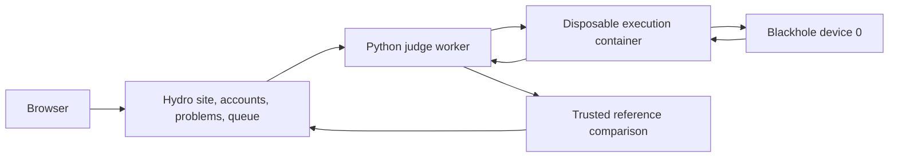

# TTOJ — Tenstorrent Online Judge

TTOJ is an experimental online judge for Tenstorrent TTNN programs and Metalium
device kernels. It combines the [Hydro](https://github.com/hydro-dev/Hydro) OJ
with a separate Python judge worker, controlled execution containers, and
versioned correctness and profiling records.

The current deployment has been validated on two p300c cards containing four
Blackhole ASICs. **Evaluation is serial: one submission reserves the entire
device topology and uses logical device 0.** This is a platform for trusted
research users; formal performance ranking and hostile multi-tenant evaluation
are not implemented.

## Features

- English by default, with selectable English and Chinese problem statements,
  navigation, help, and performance reports.
- Administrator-created accounts; public registration is disabled in the UI and
  HTTP endpoints. Only administrators manage problems and rejudge submissions.
- Four introductory problems with accepted, wrong-answer, or compilation-failure
  examples, as applicable.
- Full output and shape comparison against a trusted manifest, including
  per-problem absolute and relative tolerances.
- Separate host synchronized-call measurements and instrumented device kernel
  cycles, with raw samples and downloadable reports.
- Schema-2 attempt archives: rejudging preserves previous attempts, including
  failures and observed interruptions.

## Architecture



The worker connects to Hydro over authenticated HTTP/WebSocket interfaces. It
has Docker access and creates the execution containers. Submitted code does not
receive the Docker socket, account credentials, reference outputs, or network
access. The website and worker are separate services in this repository.

## Included problems

| ID | Submission interface | Task | Reference implementation |
| --- | --- | --- | --- |
| TT1001 | TTNN Python `solve(a, b)` | BF16 elementwise addition | [accepted.py](problems/ttnn-add/accepted.py) |
| TT1002 | TTNN Python `solve(a, b)` | BF16 matrix multiplication | [accepted.py](problems/ttnn-matmul/accepted.py) |
| TT2001 | Metalium RISC-V C++ `kernel_main()` | Add two uint32 values | [accepted.cpp](problems/metalium-riscv/accepted.cpp) |
| TT2002 | Metalium compute C++ `kernel_main()` | Add one 32×32 BF16 tile | [accepted.cpp](problems/metalium-compute/accepted.cpp) |
| TT3001 | TT-Lang Python `vector_add(a, b, out)` | CS540 · FP32 vector addition, N up to 16,777,217 | [accepted.py](problems/ttlang-vector-add/accepted.py) |
| TT3002 | TT-Lang Python `ragged_sum(x, valid, out)` | CS540 · ragged row sums, rows up to 16,384 wide | [accepted.py](problems/ttlang-ragged-sum/accepted.py) |
| TT3003 | TT-Lang Python `ragged_softmax(x, valid, out)` | CS540 · ragged softmax, logits in [-80, 80] | [accepted.py](problems/ttlang-ragged-softmax/accepted.py) |

Python inputs are already TTNN tensors on device 0; return a device tensor.

The CS540 TT-Lang problems (TT3001-TT3003, language `ttlang`) use a different
contract: the trusted wrapper [`sandbox/ttlang/runner.py`](sandbox/ttlang/runner.py)
regenerates each test's inputs from a seed, pads them to tiles, allocates FP32
device tensors and calls the submitted `@ttl.operation` with a preallocated
`out`. It compares against a PyTorch reference in-process with per-problem
tolerances, so the manifest's expected output is only the verdict marker.
Problems are generated by `tools/generate_ttlang_problems.py`, carry a
`submission_limit` (200 by default, enforced by the site addon over all
accounts), and run in the `tt-oj-ttlang-runtime` image built by
`profiling-build/build-ttlang.sh` from the tt-lang `1.1.10.dev20260921` wheel
(bundled ttnn with the device profiler enabled). Besides host timing and device
kernel cycles, accepted cases record a device summary (device time from first
kernel start to last kernel end over all cores, cores used, effective bandwidth)
and a third pass reads the Tensix hardware counters (FPU/SFPU/unpacker/packer
busy fractions, per-thread stalls and stall reasons; `worker/perf_counters.py`).
`/leaderboard` ranks each account's fastest accepted submission by the geometric
mean of device time over the testcases. The site is English only, has a
light/dark toggle in the navigation, and opens TT-Lang problems in a split
workspace (statement left, editor with the starter code right, submissions
below). To try a solution
without Hydro or Docker: `python3 tools/ttlang_local_judge.py --problem
ttlang-vector-add --solution problems/ttlang-vector-add/accepted.py`.
For C++, submit the device kernel, not a host `main()`. The trusted host harness
creates inputs, launches the kernel, and reads the real device output. General
CMake projects, ZIP submissions, and arbitrary multi-file reader/compute/writer
programs are not supported yet.

The [official problem-source survey](docs/problem-sources.md) and
[candidate catalog](docs/problem-candidates.json) describe 15 possible next
problems with sources pinned to the SDK commit. These are proposals, not 15
additional validated benchmark tasks.

## Requirements and tested versions

- Linux x86-64 host with compatible Tenstorrent devices, installed driver and
  firmware, Docker Engine, and Docker Compose v2.
- Git and access to GitHub, GHCR, npm, and Python package repositories when
  building. The SDK build runs inside the pinned official container.
- Working Docker permissions. Some build helpers use `sg docker`; membership
  in the Docker group must be effective in the current session.
- Sufficient RAM and disk for compiling TT-Metal and building both runtime
  images. Generated SDK sources, build directories, wheels, and binaries are
  downloaded or built locally rather than committed here.
- The current worker passes `/dev/tenstorrent/0` through
  `/dev/tenstorrent/3` for topology discovery. Other topologies require a worker
  change; they have not been validated by this release.

| Component | Pinned or observed version |
| --- | --- |
| Hydro / default UI | 5.0.7 / 4.58.5 |
| TT-Metal / TTNN | v0.79.0, commit `de546d3b146758714d900f11b218c8f9c805f410` |
| Profiler runtime build | Release, Tracy enabled, light-metal trace disabled |
| SFPI inside the profiler image | 7.78.0 |
| Validated host driver / firmware | 2.10.0 / 19.13.1 |

The SDK version metadata may show `0.79.0rc2`; use the recorded commit to identify
the source. Host driver and firmware versions above describe the tested setup,
not a claim that every other combination is compatible. Installing host drivers
and firmware is outside the Compose startup procedure.

## Build and start

```bash
git clone https://github.com/gujialiang123/TTOJ.git
cd TTOJ
python3 tools/init-env.py
```

The initializer generates distinct random administrator and judge passwords in
`.env`, restricts its permissions, and refuses to overwrite an existing file.
Never commit `.env`. `.env.example` documents configurable deployment settings.

Before starting, configure the service and benchmark CPU sets for your CPU
topology. The supplied default sets reflect an eight-core/sixteen-thread tested
host; inspect physical cores and SMT siblings with `lscpu -e=CPU,CORE,SOCKET`
before assigning them. Compose defaults `JOBS_HOST_DIR` to the absolute `data/jobs`
path in the current checkout. If overriding it, use the same **host** directory
mounted into the worker at `/jobs`: the Docker daemon interprets execution
container bind mounts on the host, not inside the worker. Run Compose from the
repository root so its default path is correct.

Build the profiling-enabled runtime images first:

```bash
./profiling-build/build.sh
docker image inspect tt-oj-profiler-runtime:0.79.0 tt-oj-metalium-profiler:0.79.0
./oj.sh up
./oj.sh status
```

[`profiling-build/build.sh`](profiling-build/build.sh) clones the pinned official
TT-Metal source and submodules, compiles the SDK and Python wheel, and builds the
two images used by Compose. `oj.sh up` also checks those images and builds them
if needed. The base image is pinned by digest in the recipe; provenance is
recorded in [`profiling-build/provenance.json`](profiling-build/provenance.json).
These images are built locally; this repository does not promise a published
binary image. See [source and build scope](docs/open-source.md) for the legacy
non-profiler image and external dependencies.

Open [http://127.0.0.1:8888/](http://127.0.0.1:8888/) when the site and worker are
healthy. `./oj.sh credentials` shows the initial administrator credentials in
your local terminal. Initialization creates the configured administrator and
judge accounts and missing bundled problems. It preserves existing account
passwords and administrator edits across restarts. Changing a bootstrap password
in `.env` does not reset an existing account; keep local experiment credentials
current after changing the administrator password in the UI.

```bash
./oj.sh logs worker
./oj.sh stop              # Stop services; retain persistent volumes
./oj.sh down              # Remove service containers; retain persistent volumes
./oj.sh up
```

All Compose services use `restart: unless-stopped`. With Docker enabled at
boot, services resume after a host reboot unless they were explicitly stopped.
MongoDB is internal, and the website listens on host loopback only.
For access from a workstation, forward the local port:

```bash
ssh -L 8888:127.0.0.1:8888 user@judge-host
```

Public deployments need a configured reverse proxy or SSH forwarding endpoint
and HTTPS for browser traffic. The deployment helpers are optional examples;
replace their host, identity, ports, and paths for your environment.

## Administration and adding problems

After logging in as the configured administrator:

- `/manage/dashboard`: administration dashboard.
- `/manage/userimport`: create accounts using `email,username,password` entries;
  preview before importing.
- `/manage/userpriv`: manage account privileges.
- `/problem/create`: create problems; existing problem pages expose editing,
  test-data configuration, and file management.
- `/home/security`: change your own password.

Some sensitive operations require confirming the current administrator password.
The System navigation entry is only shown to accounts with system-management
privileges; hiding an entry is accompanied by the backend permission checks.

Each bundled `problems/<name>/metadata.json` contains the statement, language,
execution mode, tests, time limit, and numerical tolerances. The worker actually
evaluates the problem's uploaded `manifest.json`, including its inline `tests`.
Replacing separate `.in` / `.out` files alone does not update those tests.

Normal startup seeds missing problems without replacing administrator edits.
When intentionally replacing bundled problems from repository metadata, wait for
the worker to become idle and run `./oj.sh reseed`. This replaces bundled
statements, tests, and starter attachments; it is not a routine startup step.

## Profiling and research records

The normative recipe and storage schema are documented in the
[evaluation and research data protocol](docs/evaluation-protocol.md). The
executable policy is [`worker/evaluation-policy.json`](worker/evaluation-policy.json),
named `tt-oj-diagnostic-v1` and hash-pinned by the worker.

| Metric | Recipe | Meaning |
| --- | --- | --- |
| Host synchronized-call latency | First correctness/JIT call, 5 warmups, 50 samples; device profiler disabled | TTNN `solve + synchronize_device`, or Metalium enqueue + finish; includes dispatch and completion wait |
| Device kernel cycles | Separate profiler-enabled pass, 5 warmups, 10 selected repeats | Official per-device/core/RISC/stage intervals and same-core envelopes; raw cycles plus frequency-derived nanoseconds |

Container wall time used for OJ limits includes startup, device initialization,
JIT, and transfers. It is separate from both performance metrics. Memory is
sampled host-container memory, not GDDR or Tensix L1 usage.

Reports preserve raw samples, outliers, policy and source hashes, runtime image
IDs, driver/firmware observations, clocks, temperatures, and scheduling settings.
The UI shows host and device summaries separately; detailed tables and normal
logs can be expanded or downloaded. Device intervals from parallel cores/RISCs
must not be summed into a chip-wide elapsed time. A nanosecond unit or clock
resolution is not a nanosecond accuracy guarantee.

Each submission receipt or rejudge gets a new attempt ID. Restricted artifacts
are retained in `data/jobs/<record-id>/attempts/<attempt-id>/`; user-accessible
performance reports and device CSVs are stored under `data/profiles/`. The
archive includes failures and observed interruptions. SHA-256 inventories check
consistency; they are not signatures or immutable storage. Retention is currently
indefinite and operator-managed. No live records or participant data are
included in this repository.

Local administrator tools use `.env` credentials and create real submissions:

```bash
python3 tools/run_experiment.py --problem TT1001 --language ttnn \
  --reference problems/ttnn-add/accepted.py --repeats 3
sudo python3 tools/research_data.py audit --output /tmp/tt-archive-audit.json
sudo python3 tools/research_data.py export \
  --key-file data/research/pseudonym.key --output /tmp/tt-metrics.jsonl
```

Restricted archives may require administrator OS permissions. Audit/export
output paths must not already exist. Exports omit submission code, inputs,
answers, logs, usernames, and emails, but stable pseudonyms still need review
before sharing. Creating an account does not obtain permission to publish that
participant's code or research data.

## Validation

Tests using temporary fixtures can run without devices or live OJ data:

```bash
python3 tools/test_research_data.py
python3 sandbox/metalium/test_device_profile.py
docker compose build worker
docker compose run --rm --no-deps --entrypoint python worker -m unittest test_protocol
```

The protocol tests mock execution and Docker access. For a running hardware
deployment, the following script submits accepted and failing examples through
the real site and waits for results; it generates visible submission records:

```bash
python3 tools/check_e2e.py
# Optional: output-limit, 120-second timeout, and post-timeout hardware check
python3 tools/check_e2e.py --extended
```

The tested implementation has produced AC, WA, CE, and RE outcomes on the
Blackhole setup, with separate host/device samples. Re-run hardware validation
on your own deployment rather than treating those observations as transferable
performance guarantees.

## Current limits

- One worker and a whole-topology advisory lock; no per-ASIC parallel scheduler.
  Hydro task priority applies, but equal-priority tasks are not guaranteed FIFO.
- CPU affinity separates OJ and benchmark CPU sets. It does not isolate OS
  tasks or interrupts. Other host programs can bypass the advisory device lock.
- Execution containers use UID/GID 1005, no network, a read-only root, dropped
  capabilities, and bounded memory/output. The worker itself is trusted and has
  administrative Docker access.
- Submitted Python shares a process with its wrapper and can tamper with APIs,
  markers, or timings. Accelerator use and timing authenticity are not attested.
  Faulty kernels may affect the shared device topology; automated recovery from
  all hardware hangs has not been established.
- Profiling is diagnostic: insertion overhead, cache/thermal differences, host
  scheduling, and device-clock stability remain sources of uncertainty. Formal
  performance ranking is disabled.

## License and source availability

TTOJ-authored source is released under **AGPL-3.0-or-later**. Third-party and
adapted code retains its original notices and applicable licenses, including
Apache-2.0 Tenstorrent examples. See [LICENSE](LICENSE),
[NOTICE](NOTICE), and
[open-source scope](docs/open-source.md).

Hydro and TT-Metal are installed or built from their pinned upstream sources;
this repository contains the integration, templates, worker, harnesses, policies,
and build/deployment scripts. Operators deploying a modified version should
provide users with access to the corresponding source of that deployed version.
This project is not an official Tenstorrent product or benchmark.
